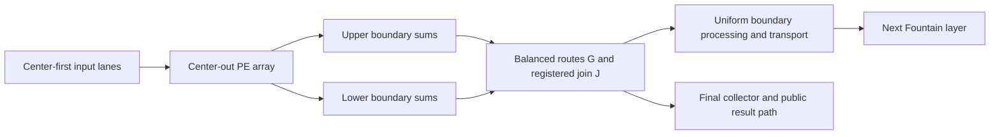

# Fountain Systolic Array Architecture Specification

Version 0.4 | 17 October 2026 | In-place RTL implementation and validation

Pre-Fountain comparison baseline: `219a081441f041aae0a83c4f44b0fc8ae266ec03`.

Status: Fountain is implemented in the existing RTL hierarchy. The default accelerator has three matrix stages and one final scalar readout. Exact-width inference and serialized full-sensitivity sign learning are implemented and simulation-verified. The pre-Fountain inward design is preserved in Git at the reviewed baseline below. Physical build status is recorded in section 14; no speedup over that baseline is claimed.

## 1 Purpose and changes from version 0.1

Fountain is a weight-stationary matrix-vector dataflow with a center-first input front. Activations travel horizontally outward from the middle column. Partial sums travel vertically outward from the middle rows. After the upper and lower sums are joined, the complete outputs have the same center-first timing pattern as the inputs. A following layer can therefore begin before the preceding layer's complete vector is available.

The architectural objective is to reduce the delay added by each dedicated layer while retaining a regular local PE network and a target initiation interval of one vector per enabled step. This changes timing constants. It does not reduce the number of dense products, the quadratic hardware of a fully spatial square layer, or the bandwidth needed to sustain that throughput.

This revision retains the version 0.1 center-out computation and registered joining adder. Version 0.2 aligned the proposal with the repository; version 0.3 added the three-stage/final-readout target and companion learning analysis; version 0.4 records the in-place implementation. The accumulated corrections and additions are:

| Topic | Revision |
| --- | --- |
| Comparison baseline | Compare with the repository's current inward, anti-diagonal-output design; distinguish it from the older conventional array |
| Interfaces | Separate the internal staggered lane interface from the public whole-vector transaction interface |
| Clock and reset | Use the repository's synchronous active-low `rst_n` and common `advance` naming |
| Joining and transport | Include physical route stages and their effect on the proposed latency advantage |
| Arithmetic | Preserve current fixed-point semantics at compatible public boundaries; make inter-layer width and binary-point conversion explicit |
| Weight loading | Preserve the existing public row-loading contract as a migration requirement; do not assume its internal shift schedule survives |
| Learning | Implement and verify full backward sensitivities with serialized training admission |
| Scaling | Distinguish depth, width, rectangular layers, and fixed-resource tiling |
| Three-stage target | Three Fountain matrix stages, with one scalar weighted readout at the final stage |
| Multilayer learning | Derive a full-sensitivity sign-update reference and distinguish it from ternary backward and direct-feedback approximations |
| Verification status | Update the existing functional/cycle models and RTL regressions; record measured coverage |

The implemented bringup target is an odd square tile, starting with N = 5, signed integer arithmetic, one complete MAC per PE step, preloaded weights, and one registered joining adder per output column. Routing, resource use and achieved frequency require separate physical reports; architectural cycle counts remain distinct from those measurements.

### 1.1 Implemented decisions

The five existing RTL files are updated in place. There is no parallel Fountain source tree. `weightStationaryProcessingElement` holds each MAC and weight; `weightStationarySystolicArray` contains the center-out grid, balanced routes and column joins; `weightStationaryMatrixMultiplier` contains the source adapter, direct layer chain, row loader, activation and final collector; `nnAccelerator` retains the public control/FIFO and final readout and adds the serial backward engine. `weightedVectorReduction` accepts the explicit final shift. A shared lane-delay helper is defined in the existing array source.

The following decisions resolve the prototype choices discussed in later design-analysis sections:

- `LAYERS=3` by default, with one scalar readout after the final matrix. `LAYERS=1` retains the original inference port width, numerical behavior and N-row host load format.
- Exact widening between layers, without requantization. Stage k (starting at 1) has width `WIDTH+k*(WIDTH+ceil(log2(N)))` and `(k+1)*FRACTION_BITS` fractional bits. The public vector/scalar port width is the final raw width plus `ceil(log2(N))`.
- One combinational activation per layer, after its complete column join. `passThrough` applies globally to every stage. The final collector is the only vector-alignment barrier.
- Source and final-collector depth-zero lanes bypass storage. From an unstalled acceptance edge E0, final raw lane j is ready at `LAYERS*D+q[j]`, result-FIFO formation at `LAYERS*D+h+1`, and earliest retirement at the next edge. N=5/LAYERS=3/G=0/J=1 gives raw [14,13,12,13,14], formation 15, retirement 16.
- Host loading is layer 0 rows N-1 through 0, then layer 1 and subsequent layers in the same order. After `LAYERS*N` accepted rows, explicit row-parallel writes take `LAYERS*N` clocks, followed by one commit edge. No layer selector port is required.
- A training sample blocks later admission. It launches learning at retirement, after earlier samples have drained. Full sensitivities from the companion analysis are computed with one time-shared multiplier/accumulator; matrix and readout weights then update together while all forward pipelines are empty. This preserves the sample's parameter generation without weight stashing.
- For nonzero error, backward work takes `(LAYERS-1)*N*N` enabled steps after retirement, followed by one commit edge. Zero error or a single layer skips the backward sums. Inference retains the II=1 target; training is serialized and deliberately differs from the old delayed SSLMS stream.
- The shared backward multiplier requests general logic through Quartus `multstyle="logic"`, reserving DSP capacity for the forward stages. Arithmetic and cycle semantics are unchanged by that mapping preference.
- Busy mode changes and readout loads are rejected and recorded in an internal sticky `configurationError`. Reload requires the complete pipeline/FIFO/training context to drain and excludes simultaneous input admission.
- The existing Quartus project selects N=5/WIDTH=8/LAYERS=3/FRACTION_BITS=0/G=0/J=1. RTL defaults remain WIDTH=16/N=3/LAYERS=3/FRACTION_BITS=4. Only odd N>=3 is supported.

Sections describing the old inward implementation refer to commit `219a081`, not the updated working tree. Remaining candidate designs, especially requantization, ternary feedback, elastic lanes and tiling, are extensions rather than implemented options.

## 2 Pre-Fountain repository baseline

### 2.1 Baseline dataflow and module boundaries

At the reviewed baseline, the accelerator was an inward, two-corner-fed design. This section records that historical behavior for comparison. It is distinct from the still older single-corner conventional baseline.

| Existing file | Historical responsibility | Consequence for Fountain |
| --- | --- | --- |
| `weightStationaryVariant/weightStationaryProcessingElement.sv` | Stationary weight, activation forwarding, MAC, saturating ternary weight update; the anti-diagonal role combines its product and two partial sums using carry-save compression followed by a carry-propagate addition | Arithmetic primitives may be useful, but PE roles and connections change |
| `weightStationaryVariant/weightStationarySystolicArray.sv` | Top-left PEs forward right/down; bottom-right PEs forward left/up; anti-diagonal PEs produce simultaneous full-column sums | Replace the topology for a Fountain candidate; the current join is local to its anti-diagonal PE |
| `weightStationaryVariant/weightStationaryMatrixMultiplier.sv` | Input register, shared two-tap row skew, N by N weight staging bank, two-ended load shifts, whole-vector result handshake, common `arrayAdvance` | Input skew, loader transfer, output validity, and busy detection require new designs |
| `weightStationaryVariant/weightedVectorReduction.sv` | Combinational full-vector weighted scalar readout with full-width accumulation and one final rescale | Requires an aligned vector or a separately specified tagged streaming readout |
| `weightStationaryVariant/nnAccelerator.sv` | Admission, paired context/result FIFOs, activation, scalar readout, retirement, SSLMS packages, reduction-weight update pipeline | Keep these responsibilities distinct from the proposed matrix dataflow |
| `memory/signedFifo.sv` | Generic signed FIFO | May be reused at transaction boundaries after capacity and timing are recalculated |

For the historical inward array, the computation and matrix update phase at PE(i,j) was:

```text
f_inward(i,j) = min(i+j, 2*N-2-i-j)
```

All output lanes finish at anti-diagonal PEs, where i+j = N-1. The matrix wrapper returns `result[j]` from PE(N-1-j,j). Its lane valids share one schedule, so the wrapper can form whole-vector validity by ANDing them.

Fountain moves the two vertical sums away from each other. Its joining network is additional explicit work compared with this existing local merge. A lower center-output cycle count alone is insufficient evidence of a faster implementation.

### 2.2 Baseline end-to-end timing

The historical unstalled timing, with an always-ready consumer, was as follows. E0 is the input acceptance edge.

| Edge | Historical behavior |
| --- | --- |
| E0 | Input vector enters the one-entry input register; context enters `sampleContextFifo` |
| E1 | The registered skew entry captures that vector |
| E2 through E(N+1) | PEs capture MAC results for inward phases 0 through N-1 |
| E(N+1) | The complete raw matrix vector is available at the anti-diagonal result registers |
| E(N+2) | Activation and scalar readout are captured in `resultFifo` |
| E(N+3) | The first result can retire; a training result starts its matrix update |

Thus the current matrix-wrapper acceptance-to-raw-result latency is N+1 edge intervals, and the integrated accelerator acceptance-to-result-FIFO latency is N+2. Neither number is the same measurement as Fountain's center-input-to-center-output D.

The current README reports a default N = 3 Cyclone V fit at a 100 MHz target, with a lowest reported Fmax of 81.16 MHz. It identifies the activation/readout path into the result FIFO as the remaining worst internal path. These are existing repository reports, not fresh measurements in this revision, and they do not characterize Fountain.

## 3 Computation, scope, and notation

The dense operation is unchanged:

```text
y[j,m] = sum(x[i,m] * W[i,j], i = 0 .. N-1)
```

The first weight index is the input index and physical PE row. The second is the output index and physical PE column. This matches the repository's row-vector convention y = xW and `reference/arithmetic.py`. For y = Ax in column-vector notation, load W[i,j] = A[j,i].

Every vector uses every weight exactly once. The center-row product belongs to one vertical sum only. The initial datapath contract keeps weights fixed while any associated vector is in flight.

| Symbol | Meaning |
| --- | --- |
| N | Square tile dimension; odd and at least 3 in the initial Fountain contract |
| c, h | Center index and maximum center-to-edge distance, both (N-1)/2 |
| a[i] | Input row offset, abs(i-c) |
| q[j] | Output column offset, abs(j-c) |
| b[m] | Enabled-step time when vector m's center activation is available for its center PE to start computing |
| f_F(i,j) | Fountain product-start offset, a[i]+q[j] |
| G | Common additional route/balancing pipeline latency between boundary-sum registers and the joining adder |
| J | Joining arithmetic latency; 1 cycle in the initial contract |
| D | Center-input-to-center-output latency, h+1+G+J |
| II | Interval between vector-center injections, in enabled steps |
| A_k | Uniform per-lane elementwise processing latency after layer k and before layer k+1 |
| R_k | Uniform, equalized inter-layer transport latency at that boundary |
| C_in | Wrapper delay from an accepted flat vector to its center computation start b, under the stated unstalled convention |
| C_sink | Additional final processing/FIFO stages after a complete aligned vector becomes available |

`R_k` is transport latency; it is unrelated to the repository's scalar-readout coefficient vector, denoted r below.

This specification distinguishes three levels of completion:

1. A fixed-weight Fountain core that obeys the lane schedule.
2. A Fountain chain and a public inference wrapper that preserve the required numerical and transaction behavior.
3. A feature-complete replacement for `nnAccelerator`, including online learning and reconfiguration.

Completing the first level does not establish the other two. In particular, the current public `trainingEnable` contract must not silently become a no-op.

## 4 Clock, readiness, and global stalls

At the start of logical interval t, the stage inputs are available. A one-cycle PE computes during t to t+1 and registers its MAC result and forwarded activation at t+1. The next PE uses those registered values in its next interval. The first center injection is time 0 in the worked examples.

An output is ready when the complete sum is available at the specified registered interface. A separate output FIFO or public handshake may add further stages. An adder settling before a capture edge does not establish a fractional-cycle latency in this model.

Use synchronous active-low `rst_n`, consistent with the repository. Reset takes priority over `advance` and clears every valid pipeline and the configuration-loaded state, including when `advance` is low. Weight bits need not be reset if unloaded weights cannot be used.

The contract has one shared `advance` for the complete connected compute domain. It freezes source skew, PE data, valids, join routes, arithmetic pipeline stages, inter-layer processing, and output alignment together. The backward engine and weight-update commit also obey that enable.

All formulas count enabled steps. Wall-clock cycles also include disabled cycles. Input admission and output FIFO retirement need their own explicit handshake rules; a wrapper must not count an unaccepted input as a center injection or consume a held internal output repeatedly during a stall.

The one-step assumption includes the complete multiply and accumulation path. Adding multiplier or MAC pipeline stages without matching activation and partial-sum delays invalidates the stated schedule. Such a change needs a new derivation, even if its eventual II remains 1.

## 5 Center-out PE dataflow

### 5.1 Input front and horizontal propagation

For vector m:

```text
input_time[i,m] = b[m] + a[i]
product_start[i,j,m] = b[m] + a[i] + q[j]
```

For N = 5, input offsets in index order are [2,1,0,1,2]. Each PE in the center column computes its product once and forwards its activation toward both horizontal neighbors. PEs left of the center forward left; PEs right of the center forward right. Each link advances data and valid by one enabled step. Activations do not move vertically for this matrix-vector operation.

A flat-vector source adapter delays lane i by a[i]. A zero-depth lane bypasses delay storage. An optional common source register is allowed, but contributes to C_in. The existing matrix wrapper's mandatory skew-entry register must not be inherited accidentally while retaining a latency formula that assumes a bypass.

An input that already has the Fountain front bypasses this source adapter. Applying a[i] again at every layer would change the intended product schedule.

### 5.2 Vertical sums

Assign the center-row product to the lower chain:

| PE row | Sum input | Registered sum |
| --- | --- | --- |
| i = c | Zero | x[i] * W[i,j] |
| i > c | Result of PE(i-1,j) | Incoming sum + x[i] * W[i,j] |
| i = c-1 | Zero | x[i] * W[i,j] |
| i < c-1 | Result of PE(i+1,j) | Incoming sum + x[i] * W[i,j] |

The upper seed starts one step after the lower seed. That later start balances the upper chain's one fewer product. Both boundary results are ready together:

```text
U[j,m] = sum(x[i,m] * W[i,j], i = 0 .. c-1)
L[j,m] = sum(x[i,m] * W[i,j], i = c .. N-1)
boundary_time[j,m] = b[m] + h + q[j] + 1
y[j,m] = U[j,m] + L[j,m]
```

Each non-seed PE consumes its activation and incoming sum for the same vector. The required expression is `result_next = incoming_sum + current_product`. Accumulating into the PE's previous result would mix vectors in an overlapping stream.

### 5.3 Worked N = 5 example

Use b = 0, G = 0, J = 1, x = [1,2,3,4,5], and W[i,j] = 5*i+j+1. The exact output is [215,230,245,260,275].

| PE row | Column 0 start | Column 1 start | Column 2 start | Column 3 start | Column 4 start |
| --- | ---: | ---: | ---: | ---: | ---: |
| 0 | 4 | 3 | 2 | 3 | 4 |
| 1 | 3 | 2 | 1 | 2 | 3 |
| 2 | 2 | 1 | 0 | 1 | 2 |
| 3 | 3 | 2 | 1 | 2 | 3 |
| 4 | 4 | 3 | 2 | 3 | 4 |

In center column 2, products are [3,16,39,72,115].

| Interval start | Center-column computation | Result available |
| --- | --- | --- |
| 0 | Row 2 seeds lower sum with 39 | Lower 39 at time 1 |
| 1 | Row 1 seeds upper sum with 16; row 3 adds 72 | Upper 16 and lower 111 at time 2 |
| 2 | Row 0 adds 3; row 4 adds 115 | Upper 19 and lower 226 at time 3 |
| 3 | Joining adder combines 19 and 226 | Full center output 245 at time 4 |

Full output readiness is [6,5,4,5,6]. First-result time is 4; full-vector time is 6.

## 6 Joining network and physical implementation

A separate joining unit for every output column receives the upper and lower boundary sums, checks in simulation that both are valid, adds at full accumulator width, and registers data and valid together.

```text
output_time[j,m] = b[m] + h + 1 + G + J + q[j]
D = h + 1 + G + J
```

The initial logical case is G = 0, J = 1, giving D = h+2. G = 0 means that there are no additional route registers before the joining adder. Wire delay still lies on the register-to-register path and must meet the selected clock period.

If the two operand routes have different latencies, balance them. If columns have different total route latencies, pad them to a common G before relying on the output-front formula. Include configuration-dependent or data-independent post-join stages in the timing ledger rather than hiding them in a wrapper.

For a straight N-row physical column, the two source registers are N-1 PE spacings apart. Any joining location requires at least one operand to traverse at least h spacings. A common enabled-step schedule does not remove that distance. If the chosen implementation needs a number of route stages that grows with N, the proposed per-layer latency benefit can shrink or disappear.

The following paths require separate implementation evidence:

1. Source storage to the center-column inputs.
2. Neighbor-to-neighbor MAC and activation forwarding.
3. Upper/lower boundary registers to the joining adders.
4. Joined output column j to the next layer's input row j.
5. Final alignment, activation, scalar readout, and result FIFO capture.

The logical j-to-j connection changes a column-indexed output arrangement into a row-indexed input arrangement. Tile orientation, placement, and routing must realize that connection. Timing-front compatibility alone does not establish a local physical layout or zero transport cost.

The proposed layer boundary is:



The next-layer path is used at an internal boundary; the collector path is used at the final sink. The diagram shows the composition choices, rather than a requirement to duplicate every output into two consumers.

A join folded into another combinational stage is an alternative design. It cannot simply remove J from the formula without showing operand availability, the resulting critical path, and the revised registered boundary. Similarly, a different layout or an inward reduction after the outward MAC wave requires its own routing and timing analysis.

Call the PE network systolic. Describe the whole implementation as strictly nearest-neighbor only after feeders, joins, control distribution, configuration, and inter-layer transport satisfy that description.

## 7 Arithmetic and compatibility with current fixed point

### 7.1 Exact integer core

Let XW be input width, WW weight width, PW product width, and AW sum width:

```text
PW = XW + WW
AW >= PW + ceil(log2(N))
```

Explicitly sign-extend each product before accumulation. Retain AW bits in both half sums and the joining addition. The initial core has no intermediate truncation or saturation. Signedness, expression widths, and constants must be explicit in SystemVerilog.

The bringup example uses XW = WW = 8 and AW at least 19 for N = 5 in its first stage. The historical repository default was WIDTH = 16 and N = 3, with single-matrix result width 34. An 8-bit Fountain prototype is not an equal-precision area or timing comparison with that implementation. The current three-stage RTL default has raw result width 70 and public result width 72.

### 7.2 Public numerical behavior

When XW = WW = WIDTH and input/weight fractional bits are both F, the raw output has 2F fractional bits and width:

```text
MATRIX_RESULT_WIDTH = 2*WIDTH + ceil(log2(N))
```

Preserve the current single-layer inference behavior when claiming compatibility:

| Operation | Existing numerical contract |
| --- | --- |
| Activation | Pass-through or ReLU once, after the complete dot product; ReLU is closed at zero for learning gates |
| Vector result mode | Activated raw matrix values, sign-extended to the public result width; still 2F fractional bits |
| Scalar readout | Sum all full-width products of activated values and signed r[j] |
| Readout coefficients | `REDUCTION_WEIGHT_WIDTH` bits, with `REDUCTION_WEIGHT_WIDTH-1` fractional bits |
| Scalar rescale | One arithmetic right shift of the complete sum by F + `REDUCTION_WEIGHT_WIDTH` - 1 |
| Scalar result width | `PREDICTION_WIDTH = 2*WIDTH + 2*ceil(log2(N))`, with F fractional bits |

The existing vector and scalar result modes have different binary points. The public output width alone does not identify the numeric format.

ReLU of U and L independently is incorrect. Bias, if introduced, is a new feature with its own format and must be included once in the complete sum before activation.

### 7.3 Inter-layer conversion

Timing-front compatibility does not imply numeric compatibility. A current raw vector with 2F fractional bits cannot be fed to a WIDTH-bit, F-fractional-bit input by merely connecting or slicing its bits.

The implementation selects exact widening at every boundary. The alternatives are:

- Exact widened arithmetic: the next input keeps the previous layer's output width and fractional-bit count. This avoids narrowing but increases subsequent multiplier and sum widths.
- Explicit requantization: specify the next input width, next binary point, shift, rounding rule, and saturation or wrap behavior. Its uniform registered latency contributes to A_k.

For example, exact integer N = 5 layers with 8-bit weights and an 8-bit first input need conservative output widths 19, 30, and 41 bits for the first three layers. Identical topology therefore does not imply identical arithmetic cost.

A possible future fixed-width policy is an arithmetic right shift followed by signed saturation. With input fractional bits F_x, weight fractional bits F_w, and next-layer fractional bits F_next, its shift is F_x+F_w-F_next. For nonnegative shifts, arithmetic right shift rounds negative nonintegral values toward negative infinity. This policy is not implemented; it would need its own numerical acceptance tests.

Apply any elementwise processing with equal latency to all lanes. Global operations such as normalization across a vector need separate buffering or streaming algorithms and are outside the direct chaining contract.

## 8 Internal lane interface and public transaction interface

### 8.1 Internal streaming interface

The names below describe the lane contract. The existing array ports use `in_data`, `in_valid`, `result`, and `resultValid` for these roles.

| Signal | Shape | Meaning |
| --- | --- | --- |
| `clk`, `rst_n`, `advance` | Scalar | Shared clock, synchronous active-low reset, common pipeline step |
| `in_data` | N signed XW lanes | Activations already arranged in the Fountain front |
| `in_valid` | N bits | Per-lane validity under the legal fixed front |
| `out_data` | N signed AW lanes | Complete column sums |
| `out_valid` | N bits | Per-column readiness |

There is no independent lane-ready signal in the initial contract. Per-lane valid does not permit arbitrary lane timing: each admitted vector must supply every lane at b[m]+a[i]. A missing vector start creates a translated bubble pattern. An absent or late individual element of an otherwise admitted vector is a protocol violation.

A non-seed MAC consumes its activation and incoming partial sum on the same enabled step. The fixed front guarantees that pairing, so one valid bit per hop marks both registered outputs. The joining unit asserts in simulation that its two sums arrive valid together. A bubble clears the next valid bit. Reset flushes all in-flight valid state.

Vector identity is not carried. With one shared `advance` and a fixed front, the vector on lane j at enabled step t is determined by t and j alone, and vectors leave in admission order. Hardware therefore needs no tag storage or comparison, and testbenches recover each element's sample index by counting arrivals per lane. Configuration epochs are separated by draining before reload, not by identity.

### 8.2 Why current whole-vector validity cannot be reused directly

With II = 1 and b[m] = m, N = 5 outputs at time 6 can all be valid while referring to vector indices:

```text
lane index:      0  1  2  3  4
vector index:    0  1  2  1  0
```

The historical matrix wrapper's AND of lane valids would accept a mixture of vectors at such a boundary. A scalar readout would then combine unrelated elements. The updated wrapper forms whole-vector validity only after alignment, where every lane of one vector is valid on the same step by construction.

### 8.3 Source and collector adapters

A flat source adapter delays lane i by a[i], carrying data and valid. Use it before the first core only, or when an external source genuinely supplies flat vectors.

A final collector delays output lane j by h-q[j]. Every element of vector m is then available together at:

```text
collector_time[m] = b[m] + D + h
```

The edge lanes have depth zero. A common collector register is optional and must be counted. Only after alignment may a whole-vector FIFO entry be captured.

For a single-layer public wrapper, the unstalled acceptance-to-result formation is:

```text
L_public = C_in + D + h + C_sink
```

C_sink includes any final registered processing and FIFO capture after the aligned vector; it excludes stages already counted in D. Retirement can occur on a later edge according to the public FIFO handshake. Specify both result formation and first retirement rather than reporting either as an unspecified output latency.

Do not place a collector followed by a new source-skew adapter between Fountain layers when claiming the direct streaming benefit.

### 8.4 Integration with the existing public interface

Preserving the current inference API requires the existing parallel input/result ready-valid transactions, vector/scalar output modes, weight-loading format, and quiescent reconfiguration rules.

The implemented chain is:

```text
public vector admission -> source adapter -> matrix and joins -> activation
    -> further matrix/join/activation stages -> final collector -> scalar readout
    -> result FIFO -> public retirement
```

For a dedicated chain, insert additional cores and uniform boundary processing before the final collector. A streaming scalar readout that consumes staggered lanes is a separate optimization. It must maintain independent full-precision accumulation contexts for overlapping vectors and define coefficient-version consistency; one accumulator for all currently valid lanes is insufficient.

The wrapper must reserve enough buffering or freeze the entire connected compute domain before a blocked sink can overwrite valid data. Include every in-flight vector and its associated context in admission/capacity accounting. Recalculate FIFO depths from acceptance-to-retirement timing and allowed stalls. The existing defaults `IN_FLIGHT_DEPTH = 2*N+2` and `OUTPUT_FIFO_DEPTH = 2*N` are not automatically sufficient or optimal for a new chain.

When a public result is valid and its consumer is not ready, that transaction remains stable. Internal values held by `advance = 0` must not be enqueued repeatedly. Simultaneous FIFO pop and push may preserve throughput if the control proves capacity for both.

## 9 Weight loading, configuration, and draining

The historical public interface accepted N rows in reverse order, row N-1 first, through `weightData[N]` and `weightValid/weightReady`. It staged the complete matrix, performed N internal shifts, then captured resident PE weights. The updated host interface keeps that row order and arbitrary handshake gaps, repeated for each layer in ascending layer order.

Retain that public row order and gap tolerance as the compatibility target. Fountain's outward partial-sum connections do not support the current two-ended shift sequence unchanged. Reusing the staging bank is independent of reusing those transfer paths.

Row-parallel resident writes are selected. The alternatives and their costs per matrix are:

| Candidate | Transfer cost after complete row collection | Required analysis |
| --- | --- | --- |
| Addressed one-weight-per-step configuration | N squared writes, plus an explicit commit boundary | Decode, configuration wiring, and larger reload latency |
| Row-parallel resident writes | N row writes, plus an explicit commit boundary | N-wide routing, row enables, physical timing, and configuration fanout |
| New local shift/broadcast schedule | Must be derived | Correct mapping through the new topology and exact transfer latency |

A private `cfg_we/cfg_row/cfg_col/cfg_data` port is acceptable for an isolated core prototype. It is not a replacement for the existing public row-loading interface. A host adapter may translate rows into such writes, but must report the resulting load latency. Do not claim the current N shifts plus one capture edge unless the selected transfer mechanism provides it.

Keep a loaded mask or equivalent state that proves all N squared resident weights were initialized. A commit makes a complete configuration available to computation. Partial row or scalar writes must not admit input vectors. Internal writes may update resident storage while computation is disabled; the externally visible configuration remains unavailable until commit.

Accept a reload only after all associated source lanes, PEs, join routes, inter-layer stages, collectors, input holding registers, context, and result buffers have drained. Pending training and backward/update work also count as busy. A temporarily quiet output is not proof of quiescence.

An accepted reload blocks an input acceptance on the same edge. No old-configuration vector may enter after that epoch boundary. In a shared chain, establish a chain-wide drain/commit protocol before changing any layer that could still receive old inputs.

Reset invalidates the loaded state and all in-flight transactions. `passThrough` and `reduceOutput` remain stream settings that change only when quiescent if the current API is preserved. Future requantization settings follow the same rule unless they are explicitly carried per vector.

## 10 Chaining and fair latency comparisons

### 10.1 Same-front composition

For equal square dimensions, connect complete output element j of one layer to input row j of the next. There is no logical vector transpose. Numeric conversion, if required, is part of the boundary contract in section 7.

```text
layer 1 input[i]  = b + a[i]
layer 1 output[j] = b + D + a[j]
layer 2 input[i]  = (b + D) + a[i]
```

For K dedicated layers, potentially with different D_k but the same lane front:

```text
last_output_time[j] = b + sum(D_k, k=1..K)
                         + sum(A_k + R_k, k=1..K-1) + a[j]
first_result_time   = b + sum(D_k) + sum(A_k + R_k)
full_vector_time    = first_result_time + h
```

Any final processing after the last raw sum adds its own latency. For identical D, no boundary stages, G = 0, and J = 1:

```text
first_result_time - b = K*(h+2)
full_vector_time - b  = K*(h+2) + h
```

For N = 5, three layers finish at [14,13,12,13,14], and ten finish at [42,41,40,41,42]. Each layer still depends on all of its input elements. Early work is valid because each PE receives its own required activation and sum at the correct time.

### 10.2 Normalize the compared interfaces

For topology analysis only, remove common wrapper registers and take time 0 as the first PE computation start. The current inward topology then completes a flat vector in N steps. Fountain produces its first element at h+2 and its full vector at 2h+2 = N+1 when G = 0 and J = 1.

An ideal cascade of inward layers therefore has full-vector time K*N, while the ideal Fountain chain has K*(h+2)+h. The inward cascade is an analytical comparison, not an implemented multi-layer design in this repository. Both cases assume compatible numerical formats and omit added inter-layer processing/transport.

| N | Inward single full vector | Fountain single first/full | Inward three layers full | Fountain three layers full | Inward ten layers full | Fountain ten layers full |
| --- | ---: | ---: | ---: | ---: | ---: | ---: |
| 3 | 3 | 3 / 4 | 9 | 10 | 30 | 31 |
| 5 | 5 | 4 / 6 | 15 | 14 | 50 | 42 |
| 9 | 9 | 6 / 10 | 27 | 22 | 90 | 64 |
| 17 | 17 | 10 / 18 | 51 | 38 | 170 | 108 |
| 33 | 33 | 18 / 34 | 99 | 70 | 330 | 196 |

Under these assumptions, Fountain has a lower full-vector cycle count only when:

```text
K*(h-1) > h
```

For N = 3 it has no cycle advantage in this comparison. For N = 5 it needs at least three layers for a strict full-vector improvement. At N = 5 and K = 3, the ideal saving is only one cycle across the entire chain, so one additional total stage erases it. G = 1 in every Fountain layer would give a full-vector time of 17 rather than 14.

For common G with J = 1, and otherwise unchanged ideal assumptions, the condition becomes:

```text
K*(h-1-G) > h
```

These comparisons do not include differences in source/collector wrappers, processing, route latency, or clock frequency. For a hardware speed claim, compare the same accepted input and externally usable output events at each implementation's achieved frequency:

```text
elapsed_time = cycle_count / achieved_frequency
```

Use the current inward implementation as the primary baseline. Results against the earlier conventional core are a separate comparison. Do not transfer earlier latency-plot labels or a twofold speedup claim to this update.

### 10.3 Three-stage network with one final readout

The concrete depth target is three Fountain matrix stages. Each emits a vector through its selected activation/numeric boundary. Only the third stage feeds the scalar weighted readout:

```text
x -> Fountain W1 -> activation/conversion -> Fountain W2
  -> activation/conversion -> Fountain W3 -> activation -> scalar readout r
```

Each Fountain stage retains its own per-column upper/lower sum joins. Only the forward scalar readout is restricted to the final stage. A final collector can supply the existing flat-vector readout semantics; a staggered scalar readout needs a separate design.

For three N = 5 stages under the ideal assumptions of section 10.1, the final raw vector finishes at [14,13,12,13,14]. Add final processing/readout/FIFO stages to obtain the public scalar result time. The logical forward arithmetic contains 3*N squared matrix product paths, 3*N column joining adders, and N scalar-readout products; these are operation paths rather than FPGA DSP counts.

For a deeper nonlinear model, define activations between stages. A completely linear, unquantized chain is algebraically a single linear map. Inter-layer conversion, per-stage activation modes, weight loading, and context capacity remain explicit configuration requirements.

## 11 What scales and what still needs a design

### 11.1 Dedicated square layers

| Resource or property | Initial Fountain scaling |
| --- | --- |
| Stationary matrix weights | N squared words per layer |
| Active product paths for II = 1 | N squared per layer |
| Column joining adders | N, each at accumulator width |
| Sustained aggregate activation input | N words per enabled step at II = 1 |
| Sustained aggregate complete outputs | N words per enabled step at II = 1 |
| Source skew data slots | sum(a[i]) = h*(h+1), excluding common registers and sidebands |
| Optional final collector data slots | sum(h-q[j]) = h squared, excluding common registers and sidebands |
| Retained public weight staging bank | Another N squared weight words |
| K fully dedicated layers | K*N squared product paths and resident weights, before width growth |

Data-slot counts are not bit counts: multiply by each stage's width and add valid storage. Route balancing, control distribution, context, and FIFOs are additional costs. Exact-width chains increase arithmetic widths as well as layer count.

The output front can remove repeated internal collectors and source adapters. It does not eliminate storage generally. Nor does it establish improved power, achieved frequency, or asymptotic area scaling. Global `advance` distribution and configuration fanout also require implementation checks as the domain grows.

### 11.2 Rectangular layers

Equal square dimensions are sufficient for the first milestone, but are not necessary for the timing-front idea. For an odd R by C dense layer, use separate row and column centers:

```text
c_r = (R-1)/2; h_r = c_r
c_c = (C-1)/2; h_c = c_c
a_R[i] = abs(i-c_r)
q_C[j] = abs(j-c_c)
product_start[i,j,m] = b[m] + a_R[i] + q_C[j]
D_RC = h_r + 1 + G + J
output_time[j,m] = b[m] + D_RC + q_C[j]
```

The same two-chain derivation applies to odd R at least 3; begin rectangular experiments with odd C at least 3 as well. If the next layer has R_next = C and uses the same index ordering and center convention, q_C[j] equals its required input-row offset. Its output width C_next may differ. A different output width does not by itself force a full-vector barrier.

This is a derived extension, not an implemented or regression-covered capability. Unequal numeric formats and physical transport still need explicit treatment. Even dimensions need a center convention and half-chain balancing; do not imply that the existing RTL's support for even N has automatically transferred to Fountain.

### 11.3 Fixed-resource tiling

Fountain alone does not map an arbitrarily large matrix onto a fixed number of PEs. A tiled design needs a schedule, weight storage and refill protocol, input reuse, tile-level partial-sum storage, and a global output-front definition.

For row block r and column block s:

```text
p[r,s,j] = sum(x[i] * W[i,j], i in row block r)
y[j]     = sum(p[r,s,j], all row blocks r containing contributions to j)
```

Join all row-block contributions before applying ReLU, final saturation, or a bias that belongs to the complete output. Each tile's local center-first front must be reconciled with the desired global output front; concatenating local fronts does not automatically produce it.

With Q active one-product-per-step paths, an R by C dense product needs at least ceil(R*C/Q) enabled steps of product capacity per vector in a fixed integer-II schedule, before loading, communication, or utilization losses. II = 1 for an arbitrarily large dense layer is therefore not a capability of a fixed-size tile. A weight-stationary tile can reuse resident weights; external weight traffic depends on the mapping and is not assumed to equal all weights every cycle.

Fixed-size tiling is a separate architecture milestone if the main goal is larger models within a fixed device budget. The present proposal primarily improves overlap between dedicated layers.

## 12 Online learning and the selected serialized implementation

The current accelerator supports inference and on-chip sign-sign LMS. A training result launches updates only when it retires. Matrix directions are the outer product of saved input signs and column directions derived from error sign, activation gates, and the signs of the readout coefficients used for that result. Updates saturate by at most one LSB. The current result FIFO preserves the activated vector, prediction, and readout-coefficient signs together.

The existing matrix update travels with f_inward(i,j), matching the computation phase. Its reduction-coefficient update uses `REDUCTION_UPDATE_DELAY = N`. During continuous unstalled traffic, the first sample to see a source sample's update is offset by N+2 samples. Those statements are properties of the current pipeline.

Fountain computation instead uses:

```text
f_F(i,j) = abs(i-c) + abs(j-c)
max(f_F) = 2*h = N-1
```

Keeping the old inward update phase would generally allow one vector to observe different matrix generations at different PEs. A candidate coherent schedule would make updates reach each PE with the same f_F offset as computation. The relative update/read timing would then be independent of PE location, subject to an explicitly defined same-edge read-before-write rule. This is a necessary design analysis, not proof that the existing update-package wiring or timing can be reused.

The maximum Fountain PE phase is still N-1. Earlier center outputs do not imply that all products finish earlier or that the complete learning loop is halved.

Before enabling learning, the revised design must establish:

1. A distribution network for row and column directions with the required Fountain phase and physically counted transport.
2. Consistent weight-generation observation for every vector, including bubbles, global stalls, overlapping updates, reset, and reload.
3. Exact same-edge multiplication/update behavior and unchanged saturating ternary arithmetic.
4. A new alignment between matrix updates and resident readout-coefficient updates. Replacing N with D in the current delay parameter is not a derivation.
5. A coherent readout coefficient version per vector. A collector allows one flat-vector readout event; a staggered readout needs a snapshot or a correctly phased coefficient-update scheme and matching saved signs.
6. Context/result pairing and training retirement semantics consistent with the public interface.
7. A new, independently checked update-visibility result. No fixed Fountain sample-index delay is claimed here.

The implementation resolves coherence with the admission barrier in section 1.1. The single pending training sample prevents later forward work until full backward sensitivities and all updates finish. No weights change while a vector is in flight. This replaces the old wave-scheduled streaming learning rather than reusing its phase or N+2 sample-visibility formula. Continuous online-training throughput remains a future schedule problem.

For the proposed three-stage network, a sign-gradient extension is mathematically defined by a backward sensitivity for each hidden unit. The final matrix retains the current error-sign/readout-sign/gate form. Earlier matrices need weighted combinations of downstream sensitivities, whose signs can depend on magnitudes even though the final weight updates are ternary.

`Fountain_Three_Layer_Learning_Analysis.md` derives that reference, a cheaper ternary-error backward candidate, and the context/version requirements. It also gives a checked example where ternary error quantization reverses an earlier layer's update direction. The implemented rule is the full-sensitivity sign update with serialized training. The ternary backward and direct-feedback alternatives remain unimplemented experiments. Convergence on a workload and a continuous streaming-training schedule remain separate evaluations.

## 13 Implemented module responsibilities

| Existing source | Implemented responsibility |
| --- | --- |
| `weightStationaryVariant/weightStationaryProcessingElement.sv` | Stationary weight, MAC, activation forwarding, explicit configuration and saturated ternary update |
| `weightStationaryVariant/weightStationarySystolicArray.sv` | Center-out grid, per-column route balancing and registered joins, validity checks, loaded-row tracking, shared enabled-step lane-delay helper |
| `weightStationaryVariant/weightStationaryMatrixMultiplier.sv` | Center-first source, configurable direct chain, per-layer activation and learning taps, multi-layer staged row writes, final collector and common advance |
| `weightStationaryVariant/nnAccelerator.sv` | Original public signal names, admission credits, one final readout, result FIFO, training context, serial full-sensitivity backward computation and atomic updates |
| `weightStationaryVariant/weightedVectorReduction.sv` | Full product/accumulator widths and one final explicit scalar shift |
| `memory/signedFifo.sv` | Reused result buffer |
| `reference/functional.py` | Independent whole-network exact inference and atomic sign-learning reference |
| `reference/cycle.py` | Registered neighboring PE dependencies, source/join/collector state, loading, backpressure and training schedule |
| Directed and trace benches and regression scripts | Updated validation within the original repository structure |

The previous sample-context FIFO and delayed update waves are superseded by one retained training context and the serialized barrier. The readout remains a different operation from the matrix-column joins. The former inward implementation is available through Git; there is no second checked-in RTL family.

## 14 Verification status and acceptance checks

### 14.1 Completed simulation evidence

The existing regression entry point, `pwsh -File scripts/run_modelsim.ps1`, passes:

- 25 Python tests, including the hand-worked dot product, exact-width chains, single-layer fixed-point compatibility, finite-difference hidden update signs, lane timing, host loading, bubbles, stalls, reset, capacity, training queued behind in-flight inference and all-layer training.
- Seven directed matrix profiles at N=3/5/9, WIDTH=8/16, one/three layers, G=0/1 and J=1/2. The default N=3/WIDTH=16/LAYERS=3 case includes extreme dense results beyond 64 bits, checked with a bound-sized signed scoreboard. The worked timing fronts, dense arithmetic, full-vector collector, continuous inference, host gaps, downstream stalls and reset/reload pass. The bench derives each element's sample index from per-lane arrival order rather than from the design.
- Seed/non-seed PE tests for signed arithmetic, configuration, one-LSB saturation, global enable and reset priority.
- Parameter checks that reject invalid dimensions.
- Four integrated per-edge comparisons totaling 3,545 RTL edges. Profiles are N=3/LAYERS=3/F=0/G=0/J=1 (845 edges, 60 state fields), N=5/LAYERS=3/F=0/G=0/J=1 (1,212 edges, 124 fields), N=3/LAYERS=3/F=2/G=1/J=2 (989 edges, 60 fields), and N=3/LAYERS=1/F=4/G=0/J=1 (499 edges, 30 fields). Each edge compares architectural state only: public handshakes, the training barrier, result data, all resident weights and readout coefficients, and every raw lane front. Controller, loader and FIFO internals can change without editing the comparison.

The original text's `Fountain_Reference_Model.py` was not supplied. Its role is now fulfilled by the updated existing `reference/functional.py` and `reference/cycle.py`; there is no additional standalone reference file. Simulation and algebra checks establish the defined implementation behavior, not learning convergence or a speedup over the historical inward design.

### 14.2 Functional and timing acceptance contract

| Check | Required result |
| --- | --- |
| Dense arithmetic and orientation | Each output equals an independent xW dot product with asymmetric weights |
| Center count | A center-only input contributes exactly once to every output |
| Coverage | Every input basis vector reaches every output column |
| Initial timing | N = 5, b = 0, G = 0, J = 1 gives [6,5,4,5,6] |
| Added route stages | G = 1 gives [7,6,5,6,7] |
| Continuous traffic | II = 1 outputs remain correct when one physical cycle contains lanes from different vectors |
| Bubbles | Missing vector starts preserve every dependent lane's bubble schedule |
| Fronts by construction | The source adapter derives every lane from one vector valid; each join asserts that its two sums arrive together |
| Three layers | Baseline output times are [14,13,12,13,14], with no intermediate full-vector barrier |
| Chain route accounting | Three N = 5 layers each using G = 1 finish at [17,16,15,16,17] before other stages |
| Arithmetic boundary | Compare exact widened chains or the explicitly selected requantization rule; test negative and extreme values |
| Collector | All elements of each vector emerge together at b+D+h; no mix under II = 1 |
| Global stalls | Every dependent stage freezes; public outputs remain stable; held outputs are not duplicated |
| Reset | Reset flushes in-flight state even with advance low and blocks computation until weights are reloaded |
| Public loading | Reverse row order and host gaps map every weight correctly; partial loads cannot compute |
| Reconfiguration | Busy writes/reloads are rejected or flagged; accepted reload takes priority over input admission |
| Capacity | Admission never exceeds reserved context/output capacity; simultaneous pop/push and long stalls remain correct |
| Public inference | Vector/scalar modes and current fixed-point behavior agree with the existing arithmetic reference |
| Learning | Coherent W/r generations, ternary saturation, retirement semantics, and serialized visibility pass independent checks |

Use comparisons keyed by per-lane sample order and element index rather than scalar output arrival order. Distinguish arithmetic correctness, enabled-step timing, wall-clock stalls, public transactions, and physical timing in test reports.

### 14.3 Physical build and comparison requirements

The current N=5/WIDTH=8/LAYERS=3/F=0/G=0/J=1 prototype completed a fresh full compilation on 29 October 2026 using the Cyclone V `5CSEMA5F31C6` project and Quartus Lite 25.1std.0. This isolated build used the RTL and constraints from `fountain` commit `b35f894`, after vector-tag removal. The shared backward multiplier maps to general logic.

| Final post-fit metric | Result |
| --- | ---: |
| Logic utilization | 6,296 / 32,070 ALMs (20%) |
| Registers | 4,882 |
| DSP blocks | 87 / 87 (100%) |
| Block memory | 2,490 bits in 7 RAM blocks |
| Slow 85 C core Fmax | 71.26 MHz |
| Slow 0 C core Fmax | 71.00 MHz |
| Worst setup slack at the 100 MHz target | -4.084 ns |
| Minimum hold slack across reported corners | +0.126 ns |

Full compilation succeeded with zero errors, but the 100 MHz timing requirement did not close. The clock pin remains unassigned and uses non-dedicated routing. Data/control pins are virtual, with 137 input and 225 output ports unconstrained for external timing. These figures characterize the core under the existing project constraints; they are not board sign-off or a demonstrated operating frequency. The design has no remaining DSP headroom on this device.

A post-fit path report at the slow 85 C corner identifies the worst path from the final layer's `columns[4].joined[40]` register through activation/readout into the result-FIFO RAM input register. Data delay is 13.489 ns and setup slack is -4.033 ns at that corner. The final vector-to-scalar reduction is therefore a timing optimization candidate. Adding pipeline stages would require revised enabled-step timing, state checks and another fit.

The isolated snapshot and reports are retained under the ignored `build/fountain-merge-review/` directory. Its `quartus/Quartus Stuff/output_files/` contains `NN_Acceleration.fit.summary`, `.sta.summary` and `.sta.rpt`; `quartus.log`, `critical-paths.rpt` and `source-sha256.json` record the full compile, detailed paths and source hashes. The unchanged RTL also passes 25 Python tests and 3,545 integrated RTL/reference edges in `regression.log`. No matched historical-versus-Fountain physical comparison has been run. Such a comparison must use the same precision, device, constraints, workload, public endpoints, and output mode. Report cycle count and achieved clock frequency together, including multiplier/DSP mapping, logic, registers, memory, route stages, control overhead, loading time, and sustained throughput under available I/O bandwidth.

Inspect source feeding, PE paths, column joins, inter-layer wiring, and final activation/readout separately. The existing scalar-readout timing bottleneck can remain even if the matrix path improves. Repeat at multiple tile dimensions; a fit at N = 5 does not establish how G or transport grows with size.

## 15 Implemented scope and remaining extensions

| Item | Implemented scope | Remaining work |
| --- | --- | --- |
| Dataflow and joins | Center-out MACs, center counted once, explicit G/J, valid-only lanes | Physical tradeoffs across larger tile dimensions |
| Direct chain | One/three-stage RTL verified; wider depth exercised by the clocked model | Deep hardware resource/frequency characterization |
| Numerics | Exact signed widening, per-stage ReLU/pass-through, one final scalar rescale | Explicit fixed-width requantization option |
| Configuration | Layer-major reverse-row host format, row-parallel transfer and common commit | Overlapped loading/double buffering |
| Public control | Original signal names, layer-dependent result width, credit admission, common stalls and final collector | Independently elastic lane boundaries |
| Learning | Full-sensitivity one-LSB sign updates, retirement trigger, serialized admission barrier | Workload convergence measurements and continuous streaming training |
| Learning alternatives | Counterexample and derivation recorded | Ternary backward and direct-feedback comparisons |
| Rectangular layers | Odd-dimension schedule derived | Model/RTL/physical implementation |
| Even dimensions | Rejected by the initial contract | Center convention and chain balancing |
| Fixed-resource larger models | Scaling analysis recorded | Tiling, storage, global reduction/front schedule |

The implementation does not claim a twofold speedup, training convergence, fixed-resource model scaling, or timing closure at 100 MHz. Matched-profile performance and power studies remain separate from functional implementation.

## 16 Sources and scope of claims

The repository sources used for current behavior are the five RTL modules identified in section 2, `memory/signedFifo.sv`, `reference/arithmetic.py`, `reference/cycle.py`, `reference/functional.py`, `reference/test_cycle.py`, the matrix and update-wave directed benches, `README.md`, and the Quartus project/clock constraints. Source paths are relative to the repository root. The RTL and explicit interface conventions take precedence over descriptive diagrams or older performance claims.

The following external references provide background. They do not establish Fountain's correctness, novelty, timing, or implementation results:

- H. T. Kung, [Why Systolic Architectures](https://www.eecs.harvard.edu/~htk/publication/1982-kung-why-systolic-architecture.pdf), Computer, 1982.
- Nayan and coauthors, [Axon](https://arxiv.org/html/2501.06043v1), 2025. Its diagonal feeding, bidirectional propagation, and WS/IS partial-sum synchronization discussion are relevant context; its reported results and runtime formulas are not Fountain measurements.
- Boemo and coauthors, [Local vs. Global Interconnections in Pipelined Arrays](https://users.exa.unicen.edu.ar/~etodorov/Public/dcis99.pdf). Its comparison of wiring distributions motivates evaluating physical connections as well as arithmetic pipeline depth.

The companion `Fountain_Three_Layer_Learning_Analysis.md` records the learning derivation and its primary references for sign-sign LMS, backpropagation, sign-gradient updates, direct feedback alignment, and pipelined weight-version consistency.

The rectangular schedule, storage counts, latency comparisons, and resource-capacity bound in this revision are derivations under the stated assumptions. This is not an exhaustive prior-art search. No claim is made of novelty, patent status, area advantage, energy advantage, or achieved speedup. Any Fountain frequency reported in section 14 applies only to that explicitly identified physical build.
